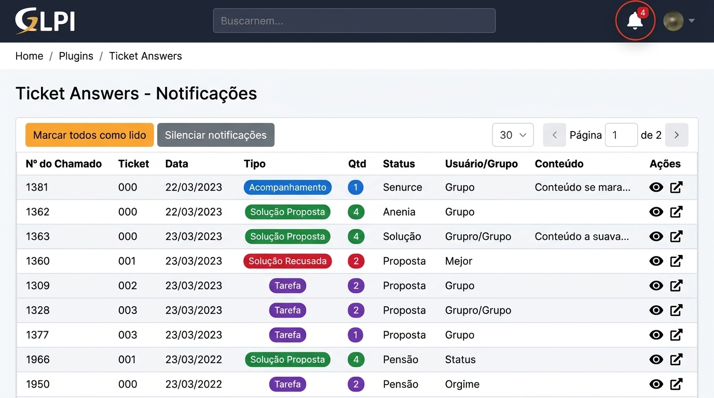
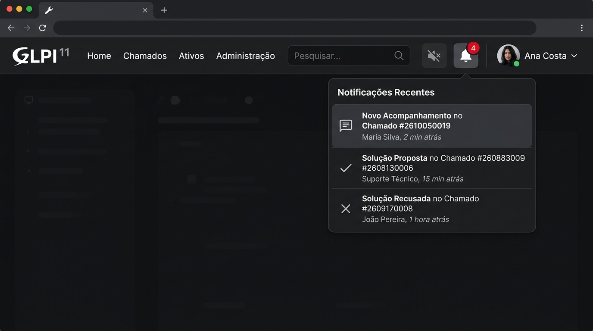

# **Plugin Ticket Answers para GLPI**

[](https://glpi-project.org/)
[](https://github.com/wilterporto/ticketanswers)
[](https://www.gnu.org/licenses/old-licenses/gpl-2.0.html)
[](https://github.com/wilterporto)

---

## **Visão Geral**

O **Ticket Answers** é um plugin para GLPI projetado para transformar a gestão de atendimento e a comunicação entre equipes e solicitantes. Com ele, nenhum detalhe ou interação passa despercebido: os usuários recebem alertas visuais e sonoros instantâneos no cabeçalho do GLPI, uma central unificada de notificações agrupada por chamado e controle total sobre o status de leitura de cada interação.

O plugin é plenamente compatível com o **GLPI 10** e o **GLPI 11**, adaptando-se perfeitamente aos temas clássicos e à nova interface moderna.

---

## **Demonstração Visual**

### 1. Central Unificada de Notificações
Painel com listagem agrupada por chamado, exibindo a interação mais recente, contador de pendências por chamado (**Qtd**), badges coloridos por tipo de interação, paginação e ações rápidas.



### 2. Notificação no Cabeçalho e Menu Rápido
Sino de alertas integrado à barra superior do GLPI, com contagem sincronizada em tempo real, suporte a aviso sonoro e atalho para a listagem completa.



---

## **Principais Funcionalidades**

### 🔔 Alertas e Contagem Precisa
- **Badge Dinâmico no Cabeçalho:** O sininho exibe o número exato de chamados com interações pendentes de leitura.
- **Notificação Sonora Configurável:** Alerta sonoro ao receber novas respostas, com botão de silenciamento instantâneo.
- **Agrupamento Inteligente por Chamado:** Em vez de poluir a tela com dezenas de linhas do mesmo chamado, o plugin exibe uma única linha por chamado com a interação mais recente e o total acumulado na coluna **Qtd**.

### 👥 Notificação para Todos os Atores do Chamado
O plugin garante que **todos os envolvidos** sejam notificados quando houver qualquer movimentação realizada por outro usuário:
- **Requerentes:** Notificados sobre respostas de técnicos, soluções propostas e solicitações.
- **Atribuídos / Técnicos:** Notificados sobre retornos do requerente, recusa de soluções e tarefas adicionadas.
- **Observadores:** Mantidos informados de todas as etapas e acompanhamentos do chamado.
- **Grupos:** Suporte completo para usuários associados ao chamado por meio de grupos de requerentes, técnicos ou observadores.

### 📋 Cobertura Completa de Interações
O plugin monitora e categoriza visualmente todos os tipos de eventos no chamado:

| Tipo | Identificador Visual | Descrição |
| :--- | :--- | :--- |
| **Acompanhamento** | `badge-primary` (Azul) | Novos comentários ou respostas de outros usuários (`glpi_itilfollowups`). |
| **Tarefa** | `badge-info` (Roxo/Ciano) | Novas tarefas técnicas adicionadas ou em andamento (`glpi_tickettasks`). |
| **Solução Proposta** | `badge-success` (Verde) | Solução submetida para avaliação e aprovação do solicitante (`glpi_itilsolutions`). |
| **Solução Recusada** | `badge-danger` (Vermelho) | Solução rejeitada pelo solicitante com o motivo da recusa. |
| **Solicitação de Validação** | `badge-warning` (Laranja) | Chamado submetido para validação formal de um gestor/usuário. |
| **Resposta de Validação** | `badge-success` / `badge-danger` | Notificação aos envolvidos informando se a validação foi aprovada ou recusada. |
| **Mudança de Status** | `badge-secondary` (Cinza escuro) | Alterações no status do chamado (Em atendimento, Solucionado, etc.). |
| **Motivo de Pendência** | `badge-dark` (Marrom/Cinza) | Chamados colocados em pendência com especificação de motivo. |
| **Novo Chamado / Atribuição** | `badge-secondary` (Cinza) | Entrada do usuário como observador ou técnico responsável no chamado. |

### ⚡ Desempenho e Usabilidade
- **Consultas Otimizadas:** Agrupamento de alta performance utilizando funções analíticas de janela (`ROW_NUMBER()` e `COUNT(*) OVER`) suportadas pelo MariaDB 10.2+ e MySQL 8.0+.
- **Ações em Massa:** Botão **"Marcar todos como lido"** para zerar as notificações pendentes com confirmação e atualização instantânea.
- **Ação Individual e por Chamado:** Visualização rápida com botão para abrir o chamado diretamente ou marcar como lido em um clique.
- **Paginação:** Seletor de registros por página (10, 20, 30, 50, 100) com controles de navegação suaves.
- **Segurança Reforçada:** Conformidade com tokens anti-CSRF do GLPI, sanitização estrita de entradas e proteção contra injeções SQL.

---

## **Tecnologias Utilizadas**

- **PHP (8.1+):** Backend robusto, integração nativa com o ORM e APIs de eventos do GLPI.
- **SQL / MariaDB / MySQL:** Consultas analíticas eficientes e indexação otimizada.
- **JavaScript (ES6 / jQuery):** Atualizações assíncronas via AJAX, manipulação de DOM e alertas de áudio.
- **CSS3 / Bootstrap:** Design responsivo compatível com a paleta visual do GLPI.

---

## **Requisitos do Sistema**

- **GLPI:** Versões **10.0.0 até 11.0.x** (Totalmente compatível com GLPI 11).
- **PHP:** 8.1, 8.2 ou 8.3 (recomendado seguir a versão exigida pela sua instalação do GLPI).
- **Banco de Dados:** MariaDB 10.2.x ou superior / MySQL 8.0 ou superior (com suporte a *Window Functions*).

---

## **Instalação e Atualização**

### Instalação Inicial
1. **Download:** Baixe ou clone este repositório para o diretório de plugins do seu GLPI:
   ```bash
   cd /caminho/para/o/glpi/plugins
   git clone https://github.com/wilterporto/ticketanswers.git ticketanswers
   ```
2. **Nome da Pasta:** Certifique-se de que a pasta esteja nomeada rigorosamente como `ticketanswers`.
3. **Painel GLPI:** Acesse o GLPI com perfil administrador e vá até **Configurar > Plugins**.
4. **Instalar e Ativar:** Localize o plugin **Ticket Answers**, clique em **Instalar** e em seguida em **Ativar**.

### Atualização de Versões Anteriores
1. Substitua os arquivos da pasta `plugins/ticketanswers` pela versão mais recente.
2. Acesse **Configurar > Plugins** no GLPI.
3. Se o botão **Atualizar** estiver visível, clique nele para executar as migrações automáticas de banco de dados.
4. Recarregue a página (`Ctrl + F5`).

---

## **Como Utilizar**

1. **Acompanhar Notificações:** No canto superior direito, ao lado do campo de busca, observe o ícone de sino 🔔. O badge vermelho indica o número de chamados com novidades.
2. **Acessar a Central:** Clique no sino para abrir a listagem completa de notificações.
3. **Interagir:**
   - Clique no ícone de olho 👁️ para marcar uma notificação como lida;
   - Clique no ícone de link externo 🔗 para abrir o chamado diretamente em nova aba;
   - Clique no botão **"Marcar todos como lido"** para limpar todas as pendências;
   - Clique no botão **"Silenciar notificações"** para ativar ou desativar o aviso sonoro conforme sua preferência.

---

## **Créditos e Autoria**

- **Autor e Mantenedor Atual:** **Wilter Porto**  
  - *Repositório:* [https://github.com/wilterporto/ticketanswers](https://github.com/wilterporto/ticketanswers)  
  - *Versão Atual:* **1.6.0**  
  - *Contato:* [wilter.porto@gmail.com](mailto:wilter.porto@gmail.com)  
  - *Contribuições:* Compatibilidade com GLPI 11, unificação de contagens, agrupamento por chamados, inclusão de tarefas e soluções nas notificações, otimização com window functions e ajustes de segurança CSRF/SQL.

- **Autor Original:** Jeferson Penna Alves  
  - *Versões Iniciais (1.0 - 1.1)*
